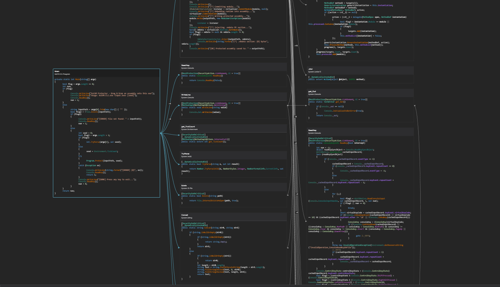
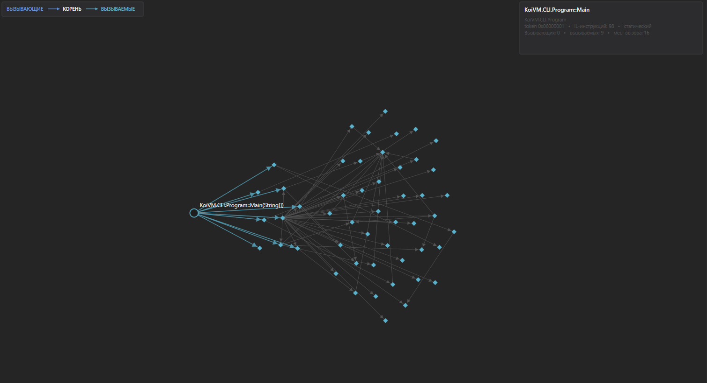
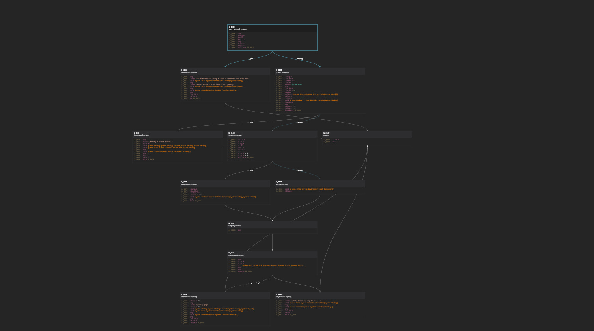

# dnSpy.Extension.CallGraph

Call Graph is a dnSpyEx extension that adds three complementary views for analyzing .NET code:

- **Call Blocks** — a call graph with decompiled C# or IL inside each node;
- **Function Map** — a compact map of relationships between large numbers of methods;
- **CFG** — an IL basic-block control-flow graph for a single method.

The extension opens as a standard dnSpy document tab. It can be docked next to the decompiler, moved to another tab group, or placed where the decompiler normally appears.

## GUI

### Call Blocks



### Function Map



### Control-Flow Graph



## Features

- `Callees`, `Callers`, and `Both` graph directions;
- a shared index of all .NET modules loaded in Assembly Explorer;
- cross-assembly call discovery;
- C# and IL inside blocks, using colors from the current dnSpy theme;
- a Function Map capable of displaying up to 2,000 methods;
- a CFG with branch, switch, fall-through, and exception edges;
- method search by name, declaring type, or full signature;
- graph depth from 1 to 8;
- independent limits for Call Blocks, Function Map, and CFG;
- Back/Forward navigation and root-method centering;
- cursor-centered mouse-wheel zoom;
- panning with the left or middle mouse button;
- automatic updates after IL/C# edits or Assembly Explorer changes;
- configurable method filters;
- a rebindable keyboard shortcut;
- English and Russian localization;
- automatic adaptation to the active dnSpy theme without custom theme color keys.

## Views

### Call Blocks

Call Blocks displays method calls as connected cards. The root method is placed in the center, callers on the left, and callees on the right.

Each card uses the actual output produced by the selected dnSpy decompiler. C# and IL are supported, together with syntax highlighting, long-line wrapping, and automatic truncation of exceptionally large methods. Decompiler comments, including `Token`, `RID`, and `RVA` metadata lines, are omitted from graph blocks.

Repeated calls to the same method are combined into a single edge labeled `×N`. The edge tooltip lists the opcode and exact IL offsets of the call sites.

### Function Map

Function Map is designed for quickly reviewing large graphs. It displays the relationship structure without creating a separate WPF control for every method.

- callers are placed on the left;
- the root method remains in the center;
- callees are placed on the right;
- arrows always point from the caller to the callee;
- the selected node shows its token, IL size, caller count, callee count, and call-site count.

Node and edge geometry is cached and rendered in batches, keeping the map responsive when working with large assemblies.

### CFG

The CFG is built directly from `MethodDef.Body.Instructions` and divides a method's IL into basic blocks.

Block leaders include:

- the first instruction in the method;
- branch and switch targets;
- instructions following terminators;
- exception-handler boundaries.

Double-clicking a referenced method name rebuilds the CFG for that method. Opening the method in the standard decompiler is available explicitly through the context menu.

## Graph Directions

| Mode | Displayed methods |
| --- | --- |
| `Callees` | Methods called by the selected method |
| `Callers` | Methods that call the selected method |
| `Both` | Both directions at the same time |

In `Callees` mode, the extension reads IL only from methods that are actually reachable within the selected depth and node limit. Because .NET metadata does not contain reverse call references, `Callers` mode builds a reverse index from the loaded modules.

## Installation

1. Download `CallGraph.Extension.x.dll` from the Releases page.
2. Close dnSpyEx.
3. Create the following directory:

   ```text
   <dnSpy>\bin\Extensions\CallGraph
   ```

4. Copy the DLL into it:

   ```text
   <dnSpy>\bin\Extensions\CallGraph\CallGraph.Extension.x.dll
   ```

5. Start dnSpyEx.

Open a method and select `View -> Call Graph`, press `Ctrl+Alt+G`, or use `Show in Call Graph` from the Assembly Explorer or decompiler context menu.

## Usage

1. Load one or more .NET assemblies into Assembly Explorer.
2. Select a method in the tree, or place the caret inside a method in the C#/IL view.
3. Open Call Graph.
4. Select `Call blocks`, `Function map`, or `CFG`.
5. For a call graph, choose its direction, depth, and node limit.

### Context Menu

- `Explore calls from here` — make the method the graph root;
- `Show method in CFG` — open the referenced method in the CFG;
- `Open source in new tab` — open the method in the decompiler;
- `Copy full name` — copy the full method signature;
- `Copy block IL` — copy the instructions from the selected CFG block.

## Search

Search is available in Call Blocks and Function Map. It matches method names, declaring types, and full signatures.

- `Enter` — move to the next match;
- `Shift+Enter` — move to the previous match;
- the matching node is highlighted and brought into view automatically.

## Settings

All settings are available under `Edit -> Options -> Call Graph`.

| Setting | Description |
| --- | --- |
| `Lines` | Maximum number of lines in a method card; Auto shows regular methods in full and truncates exceptionally large methods |
| `Block width` | Width of Call Blocks cards |
| `Wrap long lines` | Wrap long source lines |
| `Syntax highlighting` | Use tokens and colors produced by the dnSpy decompiler |
| `Hide system methods` | Hide methods from system namespaces |
| `Hide property/event accessors` | Hide `get_`, `set_`, `add_`, and `remove_` methods |
| `Hide constructors` | Hide `.ctor` and `.cctor` methods |
| `Only current namespace` | Show only methods from the root method's namespace |
| `Only current type` | Show only methods from the root method's declaring type |
| `Only methods with body` | Exclude methods without an IL body |
| `Minimum call sites` | Minimum number of call sites required for an edge to be displayed |
| `Shortcut` | Enable or rebind the command used to open the graph |
| `Assembly Explorer cleaner` | Optionally remove restored documents at startup |

Assembly Explorer cleaner is disabled by default. It does not affect graph construction and is enabled only when explicitly selected by the user.

## How the Graph Is Built

The graph analyzes IL rather than decompiled text. The following instructions are recognized:

- `call`;
- `callvirt`;
- `newobj`;
- `jmp`;
- `ldftn`;
- `ldvirtftn`.

The decompiler is used only to render text inside Call Blocks. Switching between C# and IL therefore does not change the discovered relationships.

Each loaded module is indexed independently. When a method is modified, only its module is invalidated, after which the shared reverse index is rebuilt. Adding or removing documents in Assembly Explorer also updates the index automatically.

Independent assemblies are indexed in parallel, with a limited worker count to avoid blocking the dnSpy interface. Resolved metadata references and decompiled snippets are cached.

## Static Analysis Limitations

- `calli`, reflection, late binding, and dynamically generated IL cannot be resolved reliably without runtime tracing;
- `callvirt` identifies the metadata target but cannot enumerate every possible runtime override;
- assemblies that are not loaded in Assembly Explorer are not included in the workspace index;
- severely malformed metadata may contain references that dnlib cannot resolve;
- depth and node limits can hide part of the reachable graph.

A call graph is not necessarily a tree: it can contain cycles, recursion, and methods with multiple parents. The extension preserves these relationships and uses a layered directed layout.

## License

This project is distributed under the [GNU GPL v3 or later](LICENSE.txt), which is compatible with the dnSpyEx license.

dnSpyEx and dnlib are separate projects and are not included in this repository.
